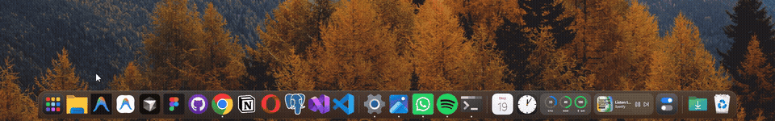
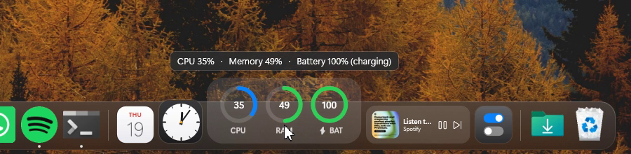

# ⚓ Harbor Dock

**A fast, beautiful, macOS-style dock for Windows 11 — built from scratch in C# / .NET 10.**

Harbor replaces the Windows taskbar with a frosted-glass dock: smooth magnification, big crisp icons, live widgets and a Now Playing panel — while idling at **~0.3% CPU and ~64 MB RAM**.





---

## ⬇️ Install (2 minutes)

1. Go to **[Releases](../../releases/latest)** and download `Harbor-win-x64.zip`.
2. Unzip it anywhere (e.g. `C:\Users\<you>\AppData\Local\Programs\Harbor`).
3. Double-click **`Harbor.exe`**. That's it — your taskbar pins are imported automatically.
4. Optional: right-click the dock → **Start with Windows**.

> Windows SmartScreen may warn about an unsigned app the first time → **More info → Run anyway**.

**To uninstall / get the normal taskbar back:** right-click the dock → **Quit Harbor**. The Windows taskbar is restored instantly.
Emergency: run `Harbor.exe --restore-taskbar`.

## ✨ Features

| | |
|---|---|
| 🔍 **Magnification** | Raised-cosine wave, frame-rate independent, adjustable (Off / Subtle / Classic / Maximum) |
| 🧊 **Frosted glass** | Native DWM acrylic blur, clipped to a rounded bar |
| 🖼️ **Hi-res icons** | 128 px shell icons, including Store/MSIX apps (WhatsApp, Spotify, Photos…) |
| 🟢 **Running apps** | Indicator dots, click to focus / minimize / cycle windows, right-click window list, Quit |
| 🌊 **Top bar (Tide Line)** | A slim frosted strip with tray icons, clock and Wi-Fi / Bluetooth / battery. Its space is reserved like a taskbar, so it never covers browser tabs or title bars. Hover anything to read its details |
| 🔔 **Tray icons** | Your apps' tray icons live in the top bar: left-click, right-click menus and double-click work as usual |
| 📅 **Widgets** | Calendar, digital or analog clock, CPU / RAM / battery rings |
| 🎵 **Now Playing** | Album art + play/pause/next for any app using Windows media controls |
| 🖥️ **Multi-monitor** | One dock per screen, per-monitor DPI aware |
| ✋ **Drag & drop** | Reorder pins, drag off to remove, drop any app/file/folder to pin |
| 🧭 **Shortcuts** | Start, Quick Settings, Downloads stack, Recycle Bin (empty from the menu) |
| 🎬 **Fullscreen aware** | Hides itself for games and fullscreen video |

## ⚡ Why it's light

- **Event-driven** — listens to `SetWinEventHook` window events instead of polling.
- **Zero idle frames** — the animation loop attaches only while something moves, then detaches.
- **Redraw only on change** — widgets skip updates when the value is the same.
- **Small layered surface + software rasterizer** — cut memory from 113 MB to 64 MB vs. the GPU path.
- No WMI, no performance counters — CPU/RAM/battery come straight from kernel32.

## ⚙️ Settings

Right-click the dock for icon size, magnification, widgets, clock style (digital / analog / both), seconds, the top bar, hiding the Windows taskbar and autostart.
Everything is stored in `%APPDATA%\Harbor\config.json`.

| In the top bar | |
|---|---|
| Wi-Fi | Click: network list · right-click: network settings |
| Bluetooth | Click: device list · right-click: turn on/off · hover: connected devices |
| Clock | Click: notifications & calendar (`Win + N`) |
| Tray icon | Click / right-click / double-click just like the taskbar |

Volume lives in Quick Settings (`Win + A`).

## 🛠️ Build from source

Requires the [.NET 10 SDK](https://dotnet.microsoft.com/download) on Windows 10 19041+ / Windows 11.

```powershell
git clone <this repo>
cd harbor-dock
dotnet run -c Release
# or a self-contained build:
dotnet publish -c Release -r win-x64 --self-contained -p:PublishSingleFile=true -o publish
```

| File | What it does |
|---|---|
| `DockWindow.cs` | Layout, magnification, animation loop, AppBar, menus, window tracking |
| `Widgets.cs` | Calendar, clock, system rings, Now Playing (vector art scaled by `Viewbox`) |
| `Apps.cs` | Window enumeration (Alt+Tab rules) and matching windows → pinned apps |
| `Shell.cs` | High-res icons via `IShellItemImageFactory`, shortcut resolution, launching |
| `TopBar.cs` | Tide Line top bar: reserved strip (AppBar), clock read-out, Wi-Fi / Bluetooth / battery |
| `TrayHost.cs` | Notification-area host: mirrors app tray icons and forwards everything to Explorer |
| `Native.cs` | Win32 / DWM / Shell interop |
| `Program.cs` | Entry point, glass window, one dock + top bar per monitor (follows monitors in and out), taskbar restore |

## 🤝 Contributing

Issues and PRs welcome — ideas: weather widget, light theme, left/right dock positions, app badges.

## 📄 License

[MIT](LICENSE) © 2026 **Saif Ur Rehman** — free to use and modify; keep the copyright notice.

*Harbor is an independent project and is not affiliated with Apple or Microsoft.*
